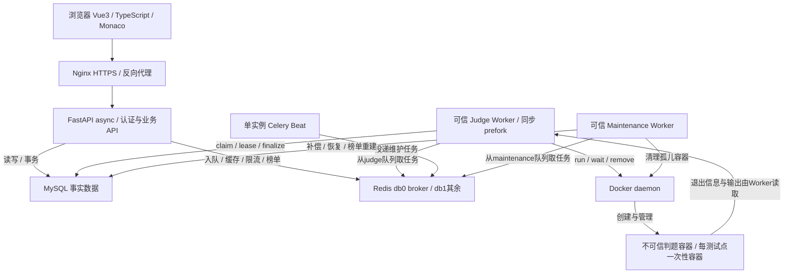

# OJ总体架构

Mermaid是本图唯一维护源；[v1.1原PNG](reference/architecture-v1.1.png)仅作存档。这里只修正任务来源、Beat调度和Docker访问箭头，不变更W5待复核策略。

用户容器无Docker socket，期望输出仅留在Worker侧。阶段06开发时API在本地运行，Compose仅起MySQL与Redis；本图描述目标逻辑架构。
