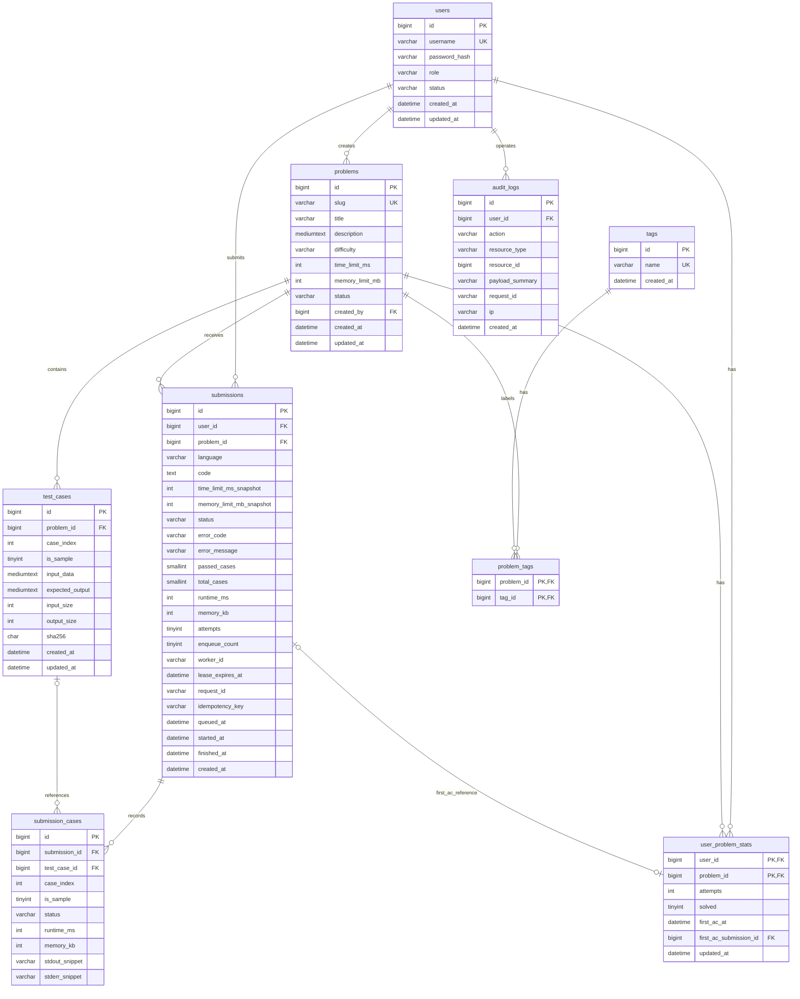

# 核心表关系

Mermaid是本图唯一维护源；[v1.1原PNG](reference/er-v1.1.png)仅作存档。修正test_cases的input_size/output_size，与已批准的限制快照及追踪/幂等字段同步。字段按设计第9章已确认定义同步，类型细节、可空性与约束以设计主本为准。

submissions的唯一幂等约束是(user_id, idempotency_key)，不是idempotency_key单列唯一。test_cases唯一约束是(problem_id, case_index)，submission_cases是(submission_id, case_index)。test_case_id在删除测试点后可空，用户/题目统计以联合主键计数。

图中类型细节、可空性、默认值与引用动作以设计第9章为准；三张文字表的完整 DDL 已于 M1 确认并写入设计 §9.2.4。audit_logs.user_id 为非空管理员引用；first_ac_submission_id 可空，其同用户、同题目及 ACCEPTED 条件由应用层校验。事务锁定方案不在本次修改范围。
